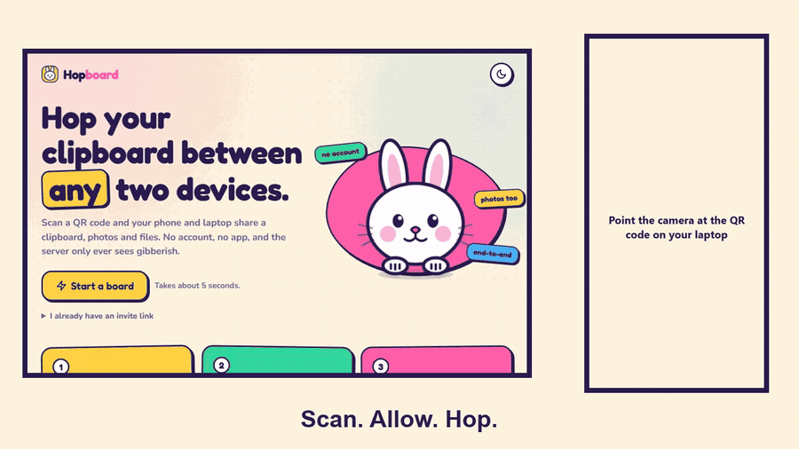

# Hopboard

[](https://github.com/blacksinisterx/hopboard/actions/workflows/deploy.yml) [](https://hopboard.pages.dev)

**Scan a QR code. Your clipboard, pictures and files hop between phone and laptop.**
End-to-end encrypted, no account, no app install, nothing stored on a server.

Live: **https://hopboard.pages.dev**



More demos: [camera to text](docs/hopboard-ocr.gif) · [what the server sees](docs/hopboard-server.gif)

## How to use it

1. Open Hopboard on one device and tap **Start a board**. It shows a QR code.
2. Point the other device's camera at it and open the link.
3. Both screens show the same five emoji. Tap **Let it in** on the first device.
4. Type, paste, drop a picture or a file. It lands on the other device.

On Android you can also install it (Chrome menu, "Install app") and use **Share → Hopboard** from any app.

## What it does

- Text, links, pictures, files. Big phone photos are shrunk on-device first (one tick to send the original).
- A numeric code like `482913` is shown in big digits with a Copy code button.
- **Video is not allowed.** Checked by declared type, file extension and the file's first bytes, on both the sending and the receiving side.
- Direct device-to-device (WebRTC) whenever the network allows it, with an encrypted relay as fallback (up to 25 MB per file) when a direct link cannot be made, for example laptop on Wi-Fi and phone on mobile data.
- The returning device reconnects on its own after a refresh, with no new approval.
- **Scan text:** photograph a page or whiteboard and the text lands in the message box, or tap **Read text** on any picture you received. Recognition runs in your browser (Tesseract, loaded once, about 7 MB). Nothing is uploaded. Works best on clean printed text.
- Light and dark themes.

## Why you can trust it (and where you cannot)

| Question | Answer |
|---|---|
| Where is the key? | A random 128-bit secret in the URL **#fragment**. Browsers never send the fragment to a server. |
| What does the server see? | Sealed envelopes only. It routes by an id derived from the secret and has no key. The in-app **Server's view** shows every frame it relays, and how many bytes of your stuff touched it (0 B when you are connected directly). |
| Can someone with a photo of the QR join? | Not silently. The first device must approve, and both screens show matching emoji so you can tell which request is yours. The invite is single-use and expires after 10 minutes. |
| Can the server swap connection details? | No. Signaling is authenticated with a key the server never has. |
| Can the server replay old messages? | Each handshake derives a fresh key from both sides' nonces, so old frames are undecryptable. A strictly increasing counter rejects replays inside a session. |
| Is video block a security feature? | No. It is a product rule enforced by the app on both sides. A hand-modified client could bypass it, because the server cannot look inside encrypted data. |
| What do devices remember? | The paired board for up to 7 days (identity key in IndexedDB, non-extractable). **Leave** forgets it. |

Not covered: a compromised device, a malicious browser extension, or a modified copy of the app served to you. Pictures are shown inline only for real image types; SVG and every other file are downloads, never opened in the page.

## Measured

| What | Result | Notes |
|---|---|---|
| Direct link on a real Android phone | Connected, picture and text delivered | One phone, one network. Not a statistical claim. |
| Connect time, two browsers on one machine | ~200 ms after approval | Loopback |
| 20 MB file, direct | Arrived intact (SHA-256 match), **0 B through the server** | ~3 MB/s on loopback in headless Chromium. Real-network speed is not measured here. |
| Relay path (no direct link) | Text, pictures and files up to 25 MB arrive intact; bigger files are refused with a clear message | Cap chosen to stay well inside free hosting limits. Speed is in the test output. |

## Limits

- Android Chrome has Share Target. **iOS Safari does not**, so on iPhone you open the app and use the buttons.
- Direct links often fail between different networks (Wi-Fi and mobile data) because of carrier NAT; the encrypted relay takes over automatically, a bit slower. No TURN server is used.
- Hosted on free tiers. Heavy use could hit daily limits.
- One partner device per board.

## Run it

```bash
cd web && npm install && npm run dev          # http://127.0.0.1:5173
cd worker && npm install && npx wrangler dev   # optional: your own relay (set VITE_WS_URL)
```

## Test

```bash
cd web
npx vitest run            # 16 unit tests: crypto, tamper/replay, pairing, video rules
npx playwright test       # 9 end-to-end tests with two browser contexts
BASE_URL=https://hopboard.pages.dev npx playwright test   # same suite against production
cd ../worker && node scripts/smoke.mjs   # relay: routing, isolation, frame cap, origin, room limit
```

The end-to-end suite (including on-device text reading from a generated image) pairs two browsers, checks matching emoji, sends text/pictures/files with hash checks, refuses video (including a renamed one), forces the relay path and then inspects every WebSocket frame to confirm the plaintext, the invite secret and the host key never appear on the wire.

## Deploy (free)

Pushing to `main` runs `.github/workflows/deploy.yml`: unit tests, type-check, build and SEO checks, then (if the token below is set) it deploys the relay and the app to Cloudflare and runs the end-to-end suite against the live site. GitHub shows the result under the repo's **Deployments** sidebar and links to https://hopboard.pages.dev.

One-time setup for GitHub deploys:

1. Cloudflare dashboard, **My Profile > API Tokens > Create Token > Create Custom Token**. Permissions: *Account > Cloudflare Pages > Edit*, *Account > Workers Scripts > Edit*, *Account > Account Settings > Read*.
2. GitHub repo, **Settings > Secrets and variables > Actions > New repository secret**: name `CLOUDFLARE_API_TOKEN`, value the token.

Without the secret the workflow still tests and builds, and simply skips the deploy.

Manual deploy still works:

- **Relay:** Cloudflare Worker + Durable Object (`worker/`, SQLite-backed class, free plan). `cd worker && npx wrangler deploy`.
- **App:** `cd web && npm run build && cd ../worker && npx wrangler pages deploy ../web/dist --project-name hopboard`.
- The relay accepts WebSockets only from `*hopboard*.pages.dev` and localhost; the app's CSP only allows connecting to that relay. Change both if you host it elsewhere.

## Layout

```
web/      React + TypeScript + Vite. src/lib: crypto.ts, net.ts (pairing, WebRTC, relay, transfer), media.ts (video rules)
worker/   Cloudflare Worker + Durable Object relay (memory only, no storage)
```

Built by Aiza Ali.
